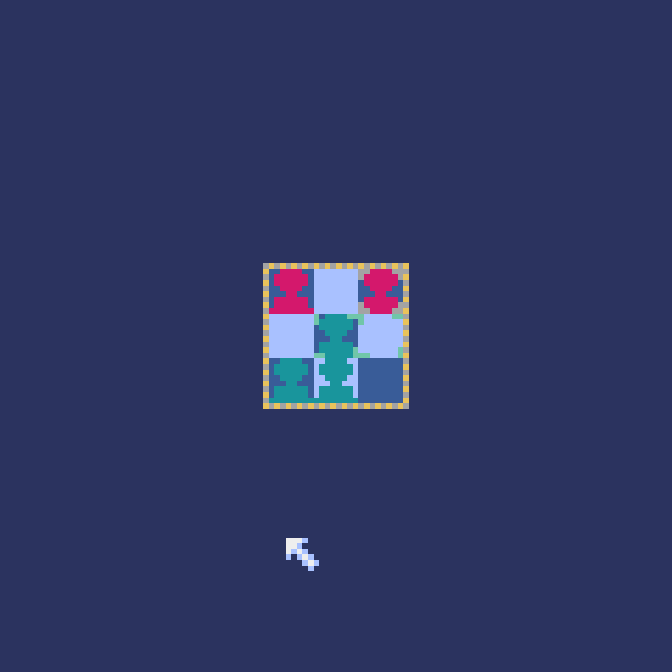
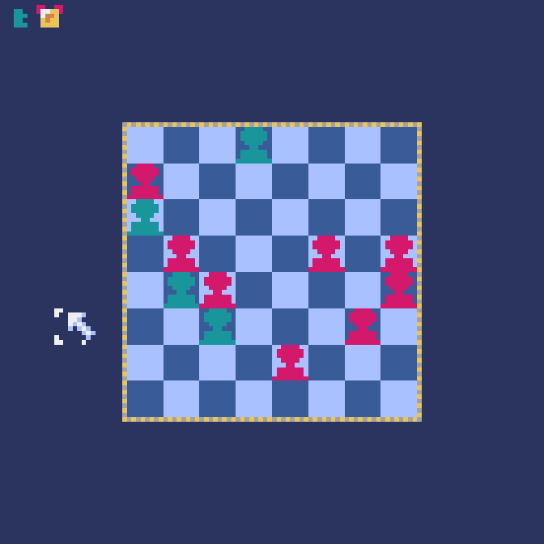
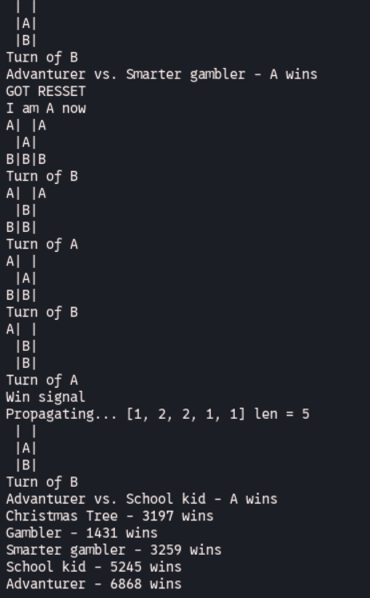
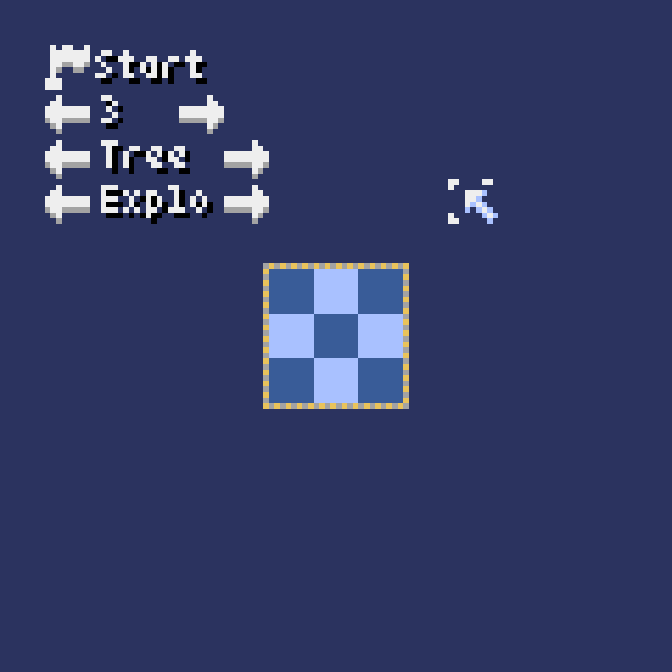
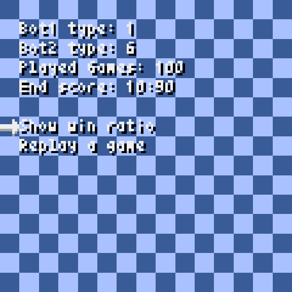
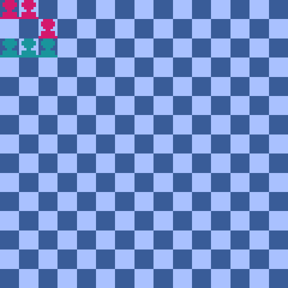
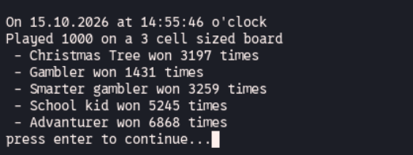
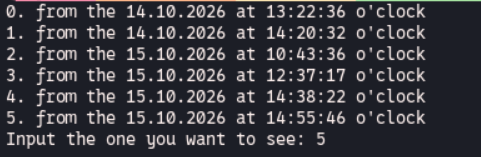
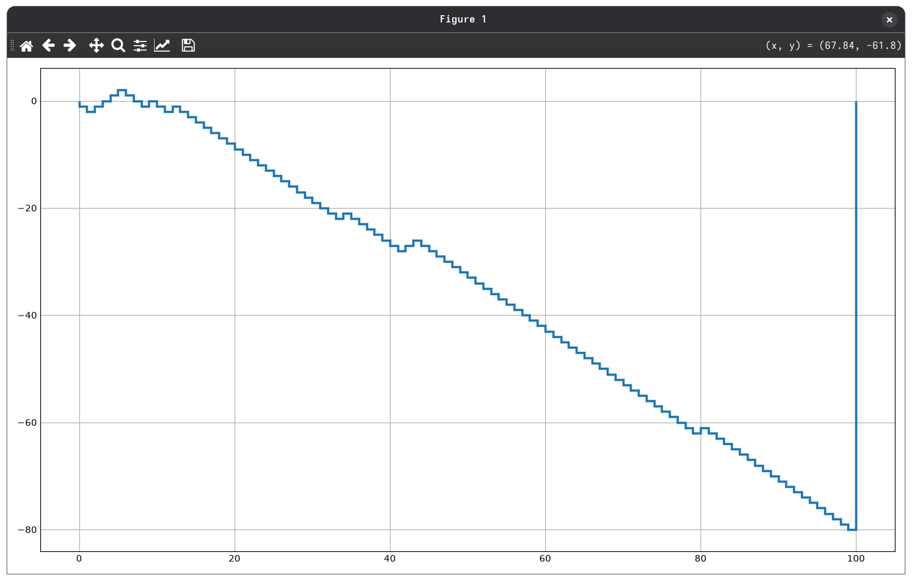
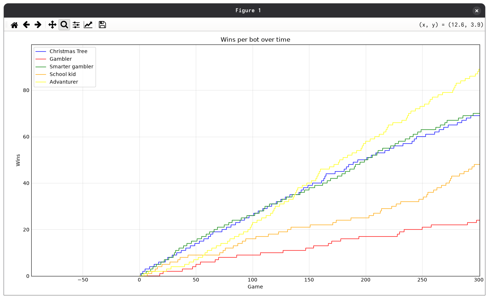

# PawnChess

Just a game of chess except that the board is 3x3 and there are only 3 pawns peaces for each player.

This project combines pawn chess with different kind of bots

## How to

If you just want to play normal execute `python pawnChess.py`. This will open up a window where you can set size of the board and against who you play. Afterwards press start. To move your peaces press them once, this will show all possible targets. Then click where you want your peace. If you play a illegal move or outside of the board it will deselect the pawn.

### Ai matching

With `python pawnChessBotHarness.py` you can let 2 bots play against each other multible times in a row without any GUI overhead. Just put in the numbers you are promptet and let the bots play.

Afterwards `python pawnChessVisualizer.py` can be called. This will bring up a window GUI with a list of all past runs of the bot matches (note the `pawnChess.py` matches are *not* recorded). You can navigate in this GUI with arrow keys and return. When you select a run you can see stats about it. Like who won most etc. including a graph that shows who won when. A stair up = A/Bot1 won, a stair down = B/Bot2 won. Also you can replay any of those matches to look how they won/lost.

> please execute at least one bot match before starting the viewer

### Tournaments

Run `python pawnChessTournament.py` to run a ternament. Each bot plays against one another (except itself) for configured numbers of rounds. Results are saved in json format and can be reviewed with `python tournamentVisualizer.py`. The viewer also creates a graph which shows the learning process of the learn-able bots exceptional well.

> please execute at least one tournament before starting the viewer

If you want to configure the tournament please edit the source code. There is a list with each Bot obj and their name placeholders you can fill or clear to edit which bots play over the add_bot() function.

### See the tree

`treeBuilder.py` creates a tree structure of all possible moves and shows it in a tk GUI. Red=A Green=B

## Explanation of bots

### RngBot

A bot who chooses a random legal move.

### DecisionBot

A bot that looks at the option and gives depending on rules each a score. Afterwards it chooses one with the highest score. Rules are:

- 2 points for capture move
- 3 points for win move when getting to the other side
- 1 point for walking in empty space

### TreeBot

A bot which creates a tree of all moves possible on the grid. Calculates with this tree what the best mathematical option is without taking strategy into account.

### LlmBot

A bot which asks over ollama a llm to play.

### ExploreBot

A bot which creates a tree structure while playing and weighting each branch depending on how much they won there. This can make it react to always same patterns the opponent uses.

### NoBot

What the name says. It is just a class to extend the other from to have the same interface of functions.

## Images of GUI and CLI/TUI

| | |
|-|-|
|||
|||
|||
|||
|||
