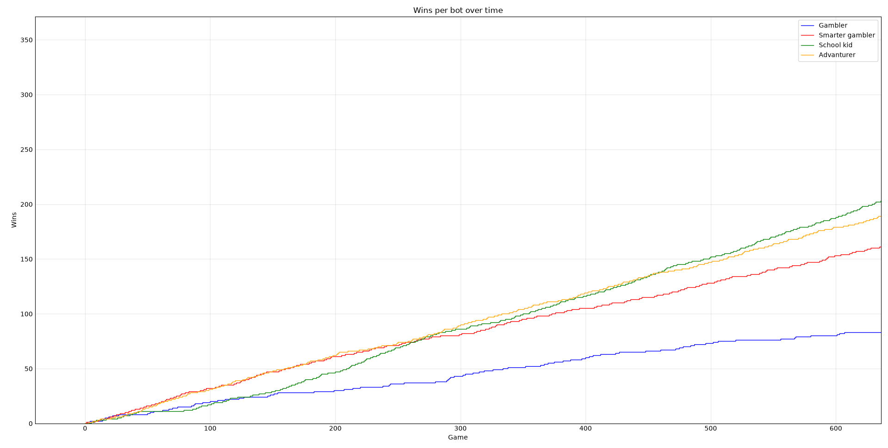
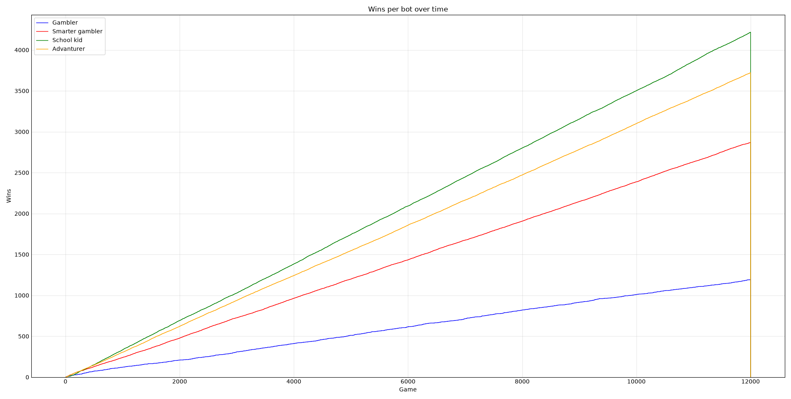
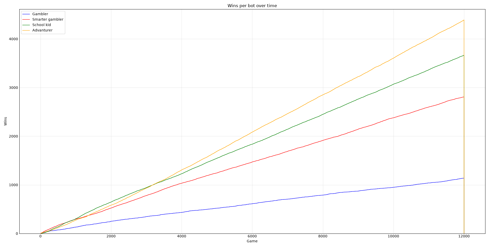
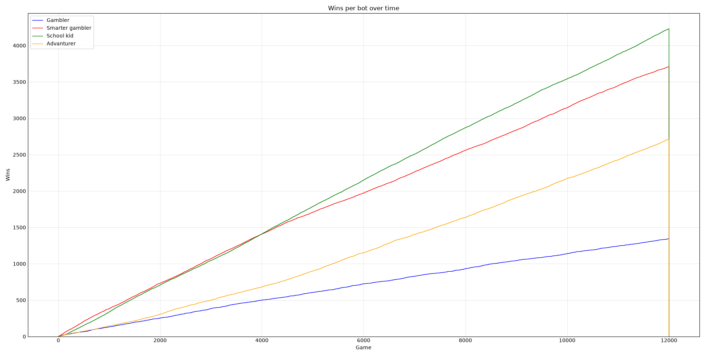
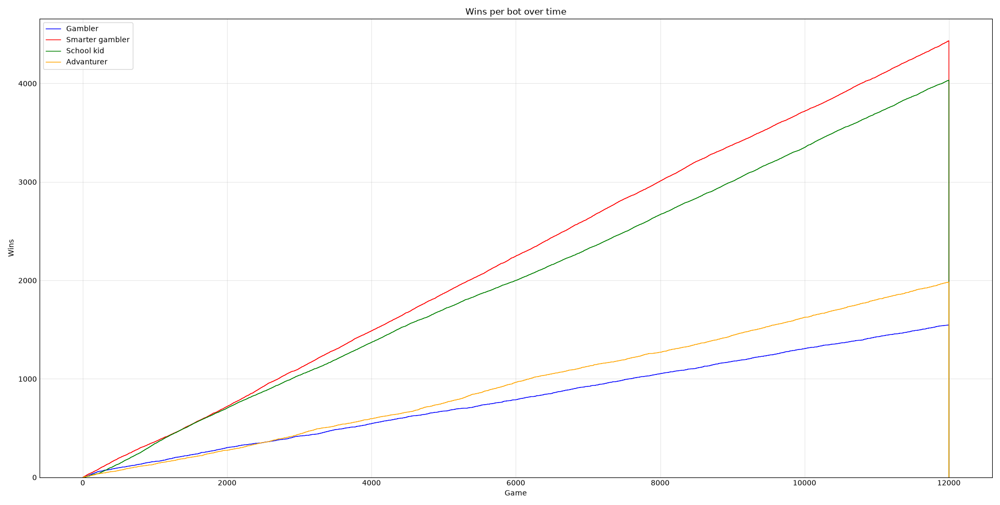
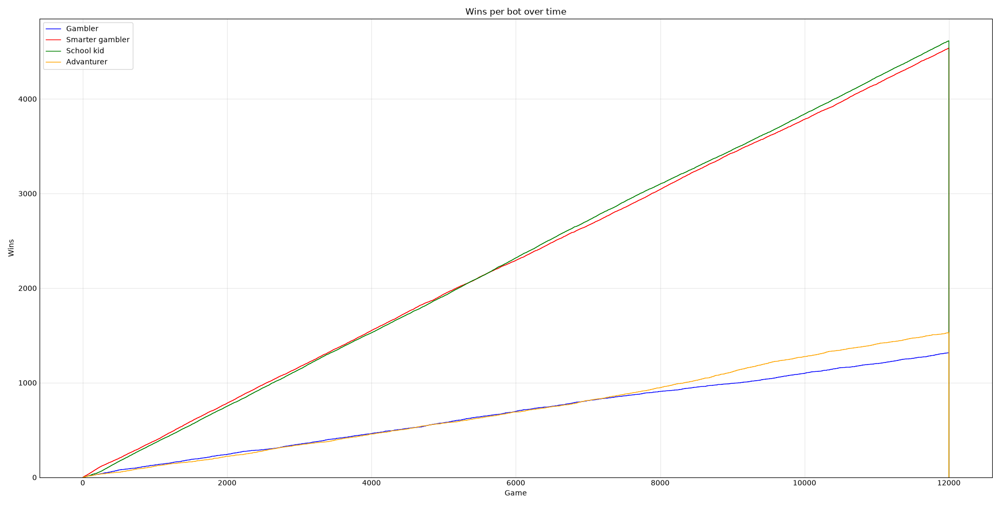
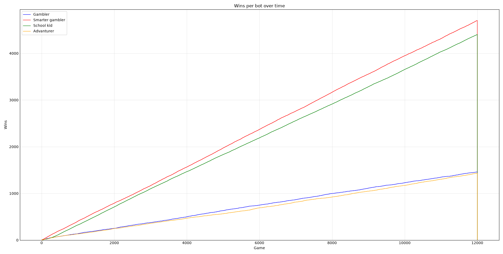
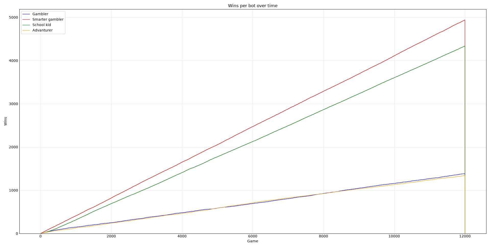
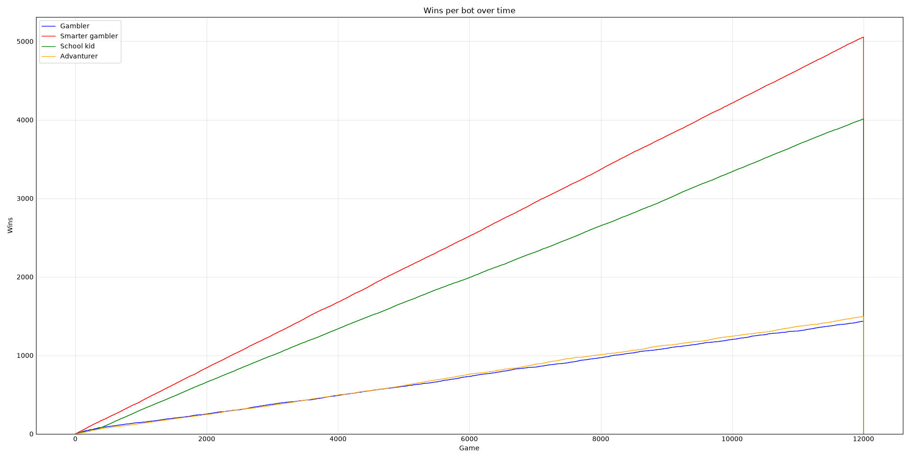
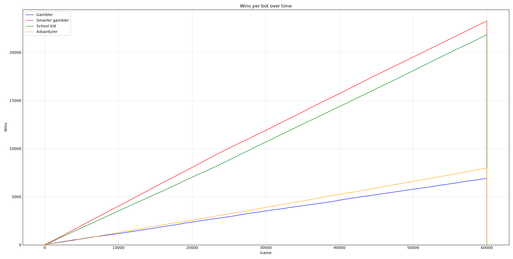

> this is a report i had to write as an a assignment. It is written in German. You do *not* need to read this. Just read the README.md

# Bauern schach mit verschidenen Bots

## Vorgehensweise

### Getestete Bots

Alle Bots haben min. 1000 Spiele gegen einander gespielt, dabei hat keiner gegen sich selbst gespielt. Bei 4 bots wären es also ``1000*3*4=12000`` Spiele insgesamt (Die Beschreibung zu jeweiligen Bots folgen). Die Ergebnisse wurden Protokoliert und mithilfe von Diagrammen analysiert.

#### RngBot

Ein bot, welcher einen zufälligen legalen zug auswählt.

#### DecisionBot

Der entscheidungs bot gibt verschidenen zügen eine Bewertung und nimmt anschließend den mit der besten Bewertung. Diese Bewertung wird an folgenen Regeln fest gemacht:

- 2 Punkte für karpern eines gegnarischen Bauern
- 3 Punkte für eien Zug in die Letzte reihe (sofortiger gewinn)
- 1 Punkt für wenn alle Felder vor dem Bauern frei sind

#### TreeBot

> WIRD NICHT VERWENDET
> da es bei größeren Feldern zu lange dauert

Ein Bott der vorher eine komplette Baum struktur generiert und dabei aufpasst welche entscheidung an welchen Ästen die meisten Gewinn chancen ergibt. Danach wird diese Struktur nicht mehr verändert.

#### LlmBot

> WIRD NICHT VERWENDET
> da ich keine genügene Rechen kapazitäten besitzte

Ein bot welcher ein LLM (Large Language Model) verwendet um Züge zu tätigen.

#### ExploreBot

Diese bot baut eine Baum struktur, wärend des spielens auf und bewertet jeden pfad mit wie heufig er dort gewonnen hat. Dadurch kann er auch, sozusagen, eine art Strategie lernen und sich seinen Gegner anpassen, anders als beim TreeBot.

#### NnBot

Ein Neurales Nets welches mit jeder Runde zu nehmend lernt und dauernd versucht zu gewinnen.

## Beobachtung

### Möglichkeiten

Bei einem 3x3 Feld gibt es nur 252 mögliche Züge, allerdings steigt diese Anzahl, schon beim 4x4 Feld, exponential auf 4197973.

### Der lern prozess

#### 3x3 Feld

Hier kann der Lernprozess vom Neuralen Netzt (School kid / ORANGE), sowie vom explore bot (Advanturer / GELB) nachvolzogen werden. Beide starten und brauchen ein wenig bis sie besser als der Entscheidungsbot sind. Aber erstmal drüber, bleiben sie drüber und nehmen nachfolgend eine lineara haltung zu, da sie lernen perfect zu spielen, schaffen die anderen bots es nicht mehr eine Konkurenz zu sein.

Das Neurale Netzt braucht etwas länger um den Erkundungsbot zu schlagen, der selbst genau zu selben Zeit all die anderen Bots schlägt, allerdings kurz danach selbst vom Neuralen netz überholt wird.

Der Entscheidungs bot kann sich schneller an gegebenheiten anpassen allerdings auch nur so gut. Das Neurale netzt ist langsamer aber kann auch komplexere Strategien besser ausführen um zu gewinnen.

Dies ist derselbe Graph, nur heraus gezoomd. Hier fellt nochmal auf wie groß der unterschied zwischen den Bots noch wird. Man merkt jedoch auch schnell, dadruch dass alle linear verlaufen, dass der Lernprozess schon bei unter 1000 aufgehört hat, da es nichts mehr zum lernen gibt.

#### 4x4 Feld

Das hier Zeigt einen Graphen von Bots die diesmal auf einem 4x4 Feld gespielt haben, statt auf 3x3. Hier fällt besonders auf dass das Neuralenetz mit dem Lernfähigen Baum bot getausch haben und dies ganze 3 mal. Dies ist allerdings nur durch kleine differenz, die sich über einen langen Zeitraum ausgeweitet hat, derartig groß. Womöglich mögen beide Algorithmen mehr optionen. Der Baum muss mehr Pfade bauen/finden/erkunden bevor er was brauchbares hat und das Neurale Netzt ist uhrsprünglich nur für 3x3 Felder entworfen worden.

#### 5x5 Feld

Hier sehen wir das Neuralnetz wieder on top, diesmal aber dicht gefolgt vom Entscheidungsbot. Der Entdeckerbot ist nach unten gesagt, da es jetzt schlicht zu viele verschidene Pfade gibt die er alle ausprobieren müsste um an etwas brauchbares zu kommen, demnach ist fast jeder Zug schlicht ein Würfel zug. Dadurch hat der Entscheidungsbot einen vorteil, weil er nicht auf Zufall sätzten muss.

#### 6x6 Feld

Ab hier begind auch das Neuralnetz zu schwächeln. Es ist einfach nicht dafür designed. Es hat zu wenig Neuronen auf den Hidden layers und alle sind mit allen verbunden, was für Neuralenetze die spielen sollen eher unproduktiv scheint. Allerdings bleibt es weiterhin mit dem Entscheidungs bot an der Spitze.

#### 7x7, 8x8, 9x9, 10x10 Felder

| | | | |
|-|-|-|-|
|||||

Ab hier streiten sich Neuralesnetz- und Entscheidungsbot ein wenig aber der Entscheidungsbot komt klar heraus, da das Neuralenetzt endgültig nicht mehr das ganze Wissen verarbeiten kann, mit seiner kleinen Größe.

#### 8x8 Feld mit 5-facher Zeit

Dieser Graph beweißt auch nochmal das es kein Trainingsproblem ist. Hier haben die Bots auf einem 8x8 Feld für das 5 fache an Zeit verbracht. Es hat sich nichts mehr verändert und alles ist linear geworden.
